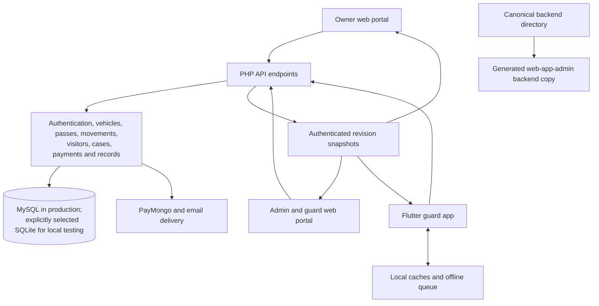

# SecurePark architecture and runtime audit

Date: 11 October 2026. Scope: the active nested repository, including the current uncommitted web, mobile, OCR, visitor, and launch-screen changes.

## Assessment

The system's core design makes sense for a campus gate application: PHP owns authorization and shared vehicle state; the owner portal displays server-issued passes; guards explicitly confirm movements; and historical offline events have unique references. A modular monolith with these three clients is appropriate. A microservice rewrite would add complexity without addressing the defects found here.

The system is **not established to be bug-free or fully production-verified**. Broad existing tests passed, but targeted fault and concurrency tests found four previously uncovered defects. Those four defects were repaired and their regression tests now pass. Further source-confirmed problems and production-specific risks remain below.

This audit inspected the critical workflow, authentication, storage, synchronization, transaction, camera, and deployment paths. It is not a claim of exhaustive execution of every input combination or every code path.

## Current architecture

The inventory contains 35 backend endpoints, 22 backend library files, 60 mobile Dart files, 25 admin JavaScript files, and 8 owner JavaScript files. The backend is mirrored for deployment; the final mirror check passed, including configuration code. Private configuration values were not included in this report.

### Workflow consistency

| Workflow | Architectural assessment |
|---|---|
| Staff sign-in and first password change | Bearer sessions are checked against active accounts; token hashes are stored server-side. The scanner authorization exception previously bypassed the required password change; repaired. |
| Vehicle registration and owner login | Registration creates the vehicle and its drivers. Owner-account creation is separately recoverable; the web UI now distinguishes that partial outcome. Registration, payment, retirement and replacement rules are primarily server-owned. |
| Payment and pass issuance | A payable registration starts unpaid; settlement activates and replaces its pass. The owner receives the server's signed QR. Sequential/mock payment scenarios pass; MySQL settlement concurrency still needs work. |
| Automatic mobile IN/OUT | Preparation is side-effect-free. A signed ticket binds the guard, checkpoint, pass, state, revision and expiry. Confirmation rechecks under a transaction/row lock, and a ticket retry returns the original result. This is the strongest command path in the system. |
| Web gate decisions | The web gate uses verification followed by log and sometimes incident requests. Stable references protect retries, but a denial log and its case are separate writes, so partial completion is possible and must remain visible. |
| Visitors | Issuance, admission and exit are distinct operations. Declared items must be checked. Pass and item creation is now atomic; creating the pass and recording admission remain separate operations with a visible partial-success warning in mobile. |
| Offline history | The queue sends events with their original timestamp and stable reference. The backend records historical events and flags unsafe admissions discovered later. This is different from the current online-only automatic movement workflow. |
| Cross-client updates | Clients poll revision snapshots, fetch affected records and acknowledge after reconciliation. This is polling-based eventual consistency, usually on a five-second interval, not instant push delivery. Failed requests and backoff can extend that delay. |

## Reproduced defects repaired in this audit

| Severity | Defect and reproduction | Repair and evidence |
|---|---|---|
| High | Enqueue event B while event A's sync request is awaiting its reply. The worker overwrote storage with its earlier snapshot; only A was delivered and B disappeared. | Reconcile the acknowledged batch against the latest queue, preserving additions made during the request. `mobile-app/test/sync_queue_concurrency_test.dart` failed before and passes after. |
| High | Sign in using a first-install temporary-password account, then call a scanner-compatible vehicle lookup directly. It reached business logic instead of requiring the password change. | `requireStaffOrScanner` now uses the normal staff password-change guard. The targeted PHP test verifies refusal before password change and access after it. |
| High | Configure an unavailable MySQL host. The backend opened its local SQLite database and returned an operational health response. A production outage could therefore create a second source of truth, potentially with a default admin. | Configured MySQL failure now returns a generic HTTP 503. SQLite is allowed only when explicitly requested or when debug mode is enabled with no MySQL identity configured. Database errors are logged server-side. |
| High | Force the visitor-item insert to fail after pass insertion. A usable pass remained without its declared items, while the request failed. | Pass, items and response preparation now share a transaction. Failure rolls back the pass and returns JSON with HTTP 503. The injected storage-failure test confirms no pass remains. |

Changed production sources: `backend/config/db.php`, `backend/lib/auth.php`, `backend/api/visitors.php`, their generated admin deployment copies, and `mobile-app/lib/services/sync_queue_service.dart`. Earlier user work was retained.

## Remaining findings, in priority order

These are open findings, not changes claimed to be fixed by the passing suites.

### 1. Mobile data is not scoped to the selected server — high, confirmed in source

`LocalCacheService` uses one set of cache/queue keys (`local_cache_service.dart:15–20`). The login screen assigns a new `ApiConstants.baseUrl` and saves it (`login_screen.dart:325`). Queue items do not record the server that originated them, and `syncEvents` posts to the current URL.

Consequently, a device with pending events can switch from server A to B and submit A's events to B after signing in there. Cached vehicle, visitor and audit records can also appear from the previous server. The storage namespace must include a stable backend identity. Existing queue data needs a migration tied to the previously stored URL; changing servers must not silently discard it. In-flight requests also need a generation check before updating a new server's cache.

Until that is implemented, a terminal with pending events should stay on its original server. This scenario was identified by tracing the code, not executed against two production systems.

### 2. Mobile dashboard totals are derived from an incomplete list — medium, confirmed in source

`GuardShellScreen` computes inside, entries and blocked counts from `_auditLogs` (`guard_shell_screen.dart:164–178`). `ApiService.fetchLogs` requests the default list, while `logs.php:33` defaults to the most recent 100 rows. The entry count also accepts any action containing `entry`, including an entry denial, and it does not filter by Manila calendar date.

The displayed totals can therefore omit vehicles still inside, count old entries, and count denied entry attempts as entries. Use server aggregates from `stats.php`, add a distinct today's-denied-attempts aggregate, and display unavailable/stale status explicitly instead of deriving operational totals from the recent activity feed.

### 3. Visitor duplicate prevention is not concurrency-safe — high, source-level race

The active plate/date check occurs before the creation transaction (`visitors.php:180`, transaction at line 189). The schema uniquely constrains `pass_code`, but not one active pass per normalized plate/date. Two concurrent requests with different pass codes can both observe no existing pass and proceed.

The new transaction fixes partial pass/item creation; it does not fix this separate race. Add an enforceable active-pass uniqueness rule or a shared plate/date lock, including the offline visitor-issuance path, and test two concurrent issuers against MySQL. The normal sequential duplicate tests passed; that does not establish concurrent safety.

### 4. Payment settlement lacks explicit serialization — high, MySQL concurrency risk

`settlePayment` starts a transaction but reads payment and vehicle rows through ordinary SELECTs (`payments.php:120–131`). Two MySQL requests can both read an unsettled state before either writes it. The cash endpoint also checks outstanding status before creating its payment.

Repeated settlement may rotate the pass again; competing payments may both miss the condition that should identify a duplicate needing a refund. Lock the relevant vehicle/payment rows in a consistent order and reread their states under the lock. Add concurrent cash/webhook/return-page tests against the production database engine. Existing sequential idempotency tests and SQLite movement tests do not prove this property for MySQL.

### 5. Offline persistence can silently become memory-only — high for durable audit expectations

`LocalCacheService.init` falls back to memory, and `_setString` ignores preference-write exceptions and the returned success flag (`local_cache_service.dart:55–91`). An operation can look queued successfully even when it will disappear on process termination. Rejected events are additionally capped at 100 records, and there is no complete operator review/retry workflow.

Move the queue to a transactional local database, make persistence failures visible before reporting an offline action as saved, and retain rejected records until explicitly resolved or exported. The repaired in-flight race does not establish crash durability.

### 6. Live polling work grows with the full database — medium, confirmed implementation cost

`updates.php:45–48` selects and hashes every row in its relevant tables on each poll. Some tables contain inline photo data. The endpoint advertises a five-second interval. As audit history, evidence and the number of terminals grow, this creates repeated database scans and serialization work even when nothing changes.

Replace full-table fingerprints with durable per-domain revision counters updated in the same transaction as writes. Return metadata without image payloads, paginate historical feeds and retrieve images on demand. Keep the current acknowledge-after-refresh behavior; it handles refresh failure correctly.

### 7. Operational audit completeness is not guaranteed — medium, confirmed behavior

`backend/lib/audit.php:20` catches audit insertion failures and only logs them to PHP's error log. A sensitive admin operation can succeed without a corresponding admin audit row. This differs from gate movement confirmation, where the gate log is part of the transaction.

Decide which audit events are mandatory. For those operations, persist an audit/outbox record within the business transaction, then deliver notifications separately. The passing live gate-audit test proves the tested entry/exit records appear; it does not prove all administrator activity is durably audited under storage failure.

### 8. UI and service code still have avoidable coupling — medium maintenance risk

The mobile HTTP service exposes global mutable `lastWriteError`, `lastResponseData`, last-created records and tokens. Repositories can read those after another request has overwritten them. Some tests automatically choose mock authentication using `FLUTTER_TEST`, so full-app widget tests do not exercise the same login implementation as a real device; separate Dart/PHP integration tests partly compensate.

Return typed results from each operation and inject API/repository dependencies explicitly. Move camera/OCR lifecycle management out of the large visitor widget. In particular, torch handling currently toggles its UI state even when the hardware call throws, and the server-test dialog calls its local setState after an await without verifying that the dialog is still mounted. These paths merit targeted lifecycle tests and hardware checks.

## Runtime and analysis evidence

All database mutations in the audit tests used disposable fixtures. No live deployment or production database migration was performed.

| Check | Result | What it establishes |
|---|---|---|
| `tests/system_validation.py` | PASS; 678 backend assertions | Broad registration, authorization, pass, visitor, payment/mock checkout, case, evidence, offline and state-transition behavior using PHP/SQLite. |
| Two-worker movement integration | PASS | Competing confirmations, stale scans and ticket retry behavior in the local SQLite fixture. |
| Revision API and two transport clients | PASS | Authenticated changes, reconciliation and session behavior. |
| PHP syntax | PASS; 110 files plus both `config/db.php` copies | Syntax only; configuration bootstrap code was checked separately because the broad runner excludes config. |
| JavaScript syntax | PASS; 33 files | Syntax only. |
| `flutter analyze --no-pub` | PASS; no issues | Dart analyzer checks. |
| Full Flutter suite | PASS; 189 tests, 2 environment-gated skips | Widgets, services, parsing, queues, layout and controlled failure scenarios, including the new queue race regression. |
| Android debug APK build | PASS | Repaired Dart code and native Android resources compile. This does not establish installed-device behavior. |
| `tests/deep_audit_regression.py` | PASS; 3 targeted scenarios | Password-change enforcement, safe database failure, atomic visitor/item creation. All three failed against the corresponding original implementation. |
| `tests/web_error_runtime.py` | PASS | Real Chrome plus PHP/SQLite: staff/owner sign-in, failed writes, form preservation, repeated clicks, partial denial retry and revoked sessions. No uncaught browser exceptions in these flows. |
| `tests/mobile_php_integration.py` | PASS | Actual Dart worker receives remote record changes and revoked-session responses from real PHP. |
| `tests/visitor_web_roundtrip.py` | PASS after repairs | Guard created through API; real Dart transport issues visitor and records entry/exit; an already-open Chrome portal shows the pass, declared items and exactly one audit per movement. Also checks invalid/duplicate web visitor submissions. |
| Backend deployment mirror and whitespace checks | PASS | Canonical and deployed copies agree; no whitespace errors in the current diff. |

The browser tests and mobile transport tests are distinct evidence. Running Dart HTTP code and rendering widgets under Flutter's test runtime does not install or exercise the native mobile app.

## Verification still required

* Real Android/iOS camera permissions, pause/resume, lens switching, torch failure, autofocus, image orientation, poor lighting, OCR recognition accuracy and low-memory behavior. An Android device/emulator and an iOS build environment were not available for this audit.
* MySQL-specific locking, isolation, migrations and concurrent visitor/payment writes. The executed backend fixtures use SQLite.
* Real PayMongo checkout and webhook delivery, actual email delivery/retries, and deployment-host behavior. Local mocks do not establish external provider operation.
* Sustained load with realistic audit history and photo volume, and restart/storage-failure recovery on the phone.

## Recommended sequence

1. Isolate each server's mobile queue/cache and make offline writes durably observable.
2. Serialize visitor issuance and payment settlement, with production-engine concurrency tests.
3. Replace mobile dashboard counters with authoritative aggregates.
4. Make required admin audit records transactional; centralize backend error responses and separate post-commit side effects.
5. Replace revision table scans with counters, then reduce inline photo traffic and paginate history.
6. Complete native camera/OCR and deployed-provider acceptance tests before calling the system production-verified.

The current evidence supports a working core workflow with four additional defects removed. The open findings above prevent a credible claim that the system has no remaining bugs.
